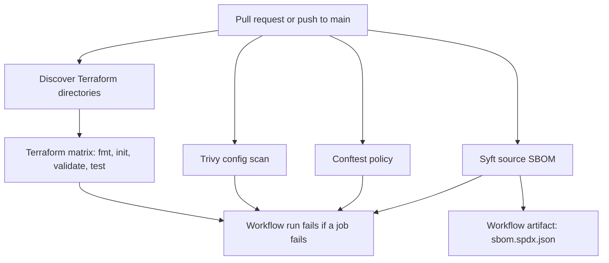

# Security pipeline

Every pull request and every push to `main` runs [`.github/workflows/ci.yml`](../.github/workflows/ci.yml). The jobs below are the security gates for this repository. They parse and test Terraform locally. Nothing in the workflow uses AWS credentials, secrets, or OIDC, and nothing applies infrastructure.

The diagram matches the workflow as it runs. The Terraform matrix waits for discovery. Trivy, Conftest, and the SBOM job start at the same time as discovery. A failed job fails the workflow run. This repository does not define branch-protection rules in code, so whether GitHub also blocks the merge button is a setting outside this workflow. The check names to require are listed under [Required status checks](#required-status-checks).



Read the gates in that order: valid Terraform, then a general misconfiguration scan, then the S3 rules this repo enforces, then an inventory of the tree the SBOM job scanned. GitHub starts the last three at the same time as discovery; only the Terraform matrix has a `needs:` dependency.

## What each gate checks

### Discover Terraform directories

The job walks `modules/`, `examples/`, and `products/`. A directory becomes a matrix entry when it contains a `.tf` file directly (not only in a subdirectory). `.terraform/` is ignored. The current tree resolves to:

- `modules/secure-s3-bucket`
- `examples/secure-s3-bucket`

`products/` is walked and currently contains only [`products/README.md`](../products/README.md), so it adds no matrix entry. The job fails if the list is empty, so a bad checkout cannot skip Terraform by producing an empty matrix.

### Terraform checks

One job per discovered directory, named `Terraform Checks (<directory>)`. `fail-fast` is off, so one broken directory does not cancel the others. Each job has `contents: read` only.

| Step | Command | What fails the job |
|------|---------|--------------------|
| Format | `terraform fmt -check -recursive` | HCL that Terraform 1.9.0 would rewrite |
| Init | `terraform init -backend=false` | A module or provider that cannot be installed. No remote backend is configured or contacted |
| Validate | `terraform validate` | A configuration that is not valid Terraform |
| Test | `terraform test` | A failing assertion in a `.tftest.hcl` file in the directory or its `tests/` subdirectory |

`terraform test` runs only when those files exist. `modules/secure-s3-bucket` has `tests/basic.tftest.hcl` (three plan runs, with `mock_provider "aws" {}`, so the plan stays local). `mock_provider` was added in Terraform 1.7.0, so `modules/secure-s3-bucket` and `examples/secure-s3-bucket` set `required_version` to `>= 1.7.0`. `examples/secure-s3-bucket` has no test file, so that job logs a skip and still runs fmt, init, and validate.

CI installs Terraform **1.9.0** with `hashicorp/setup-terraform` pinned to commit `b9cd54a3c349d3f38e8881555d616ced269862dd` (v3.1.2). 1.9.0 satisfies the `>= 1.7.0` floor. The Terraform wrapper is off so the real exit code is the one that fails the step.

### IaC security scan (Trivy)

`aquasecurity/trivy-action` at `ed142fd0673e97e23eac54620cfb913e5ce36c25` (v0.36.0) runs Trivy **v0.70.0** in config mode (`scanners: misconfig`) over the whole checkout. `severity` is `HIGH,CRITICAL` and `exit-code` is `1`, so only those severities fail the job. Medium and low findings are not a failure. `skip-dirs` is `.git`, `docs`, and `.github`. `products/` is not skipped. It has no Terraform today; a product added later is scanned because it is not in that list. The job does not keep a directory allow-list.

The same scan is written as SARIF and uploaded with `github/codeql-action/upload-sarif` at `9b3254085494b55a0f7c4c2b3d2d52cc712ce370` (v4.39.1). That upload is why this job adds `security-events: write`. Every other job stays at `contents: read`. The SARIF step uses `exit-code: 0` so a finding still reaches GitHub code scanning; the table scan above it is what fails the job.

`modules/secure-s3-bucket` encrypts with SSE-S3 (`AES256`). The encryption resource carries a resource-scoped `#trivy:ignore:AVD-AWS-0132` because a customer-managed key is a caller decision, and the ignore comment sits on that resource only. `policy/tests/insecure_s3_bucket.tf` is inside the scan (it is not under a skipped directory) and has its own resource-scoped ignores so the negative policy fixture does not fail Trivy. Those ignores do not apply to `modules/` or `examples/`.

### Policy as code (Conftest)

Conftest **0.71.1** (linux/amd64 archive SHA-256 `c3f6b2a753bd56e377a1e51a95ae3e057f926f2e9139f7d5b5dfbbaf810f7985`) evaluates `policy/terraform` with the `hcl2` parser. The job has `contents: read` only. Details of each rule are in [policy/README.md](../policy/README.md). In short, every `aws_s3_bucket` declared in a file under `modules/` or `examples/` must, in that same file:

- have an `aws_s3_bucket_server_side_encryption_configuration` whose `sse_algorithm` is a non-empty string (`S3-ENCRYPTION`)
- set all four Block Public Access attributes to the boolean `true` (`S3-PUBLIC-ACCESS-BLOCK`)
- have an `aws_s3_bucket_versioning` with `versioning_configuration.status` of `"Enabled"` (`S3-VERSIONING`)

A file with no `aws_s3_bucket` passes. `examples/secure-s3-bucket` only calls the module, so it passes for that reason. New `.tf` files under `modules/`, `examples/`, or `products/` are picked up by `find`; there is no file list in the workflow. `products/` has no `.tf` files today, so it adds no policy input.

The job also runs `conftest verify` on the policies, and it runs Conftest against `policy/tests/insecure_s3_bucket.tf` expecting exit code 1 with all three rule prefixes. A policy change that stops rejecting that fixture fails the job.

Conftest does not evaluate variables, `count`, or `dynamic` blocks. `enable_encryption` and `enable_versioning` can still be set to `false` by a caller. The resources are declared with `sse_algorithm = "AES256"` and `status = "Enabled"`, which is what the parser sees.

### SBOM (Syft)

`anchore/sbom-action` at `66cbf4bc1f1c0d2edc94016e65bc221b6bb0ad6c` (v0.24.3) generates an SPDX JSON SBOM of the checkout (`path: .`). That pin's default Syft version, from `src/SyftVersion.ts` in the action, is **v1.54.0**. The workflow does not override `syft-version`. The file is uploaded as the workflow artifact `sbom.spdx.json`. `upload-release-assets` and `dependency-snapshot` are both `false`, so the job does not publish a release asset or call the dependency snapshot API. Permissions are `contents: read`.

This job fails if SBOM generation or artifact upload fails. It does not fail on vulnerabilities. It is an inventory of this repository, not a CVE gate. `path: .` includes new modules and examples without a directory list.

### Not a merge-time gate

[Dependabot](../.github/dependabot.yml) opens weekly pull requests for the `github-actions` ecosystem and for Terraform providers under `/modules/*` and `/examples/*`. The `*` is one path segment, so a new direct child of `modules/` or `examples/` is included without editing the file, and `tests/` under a module is not a separate entry. `products/` is omitted because it has no Terraform directory. Add `/products/*` when the first product directory exists. Every action in the workflow is pinned to a full commit SHA, with the release tag in a trailing comment, so a moved tag does not change what CI runs.

## Required status checks

This file cannot see the repository's branch protection rules. Set these job names as required status checks if merges to `main` should wait for this pipeline. GitHub matches the name exactly. These are the `name:` values from [`.github/workflows/ci.yml`](../.github/workflows/ci.yml) as a pull request reports them on current `main`:

| Check name | What it gates |
|------------|----------------|
| `Discover Terraform directories` | The matrix does not run if this job fails |
| `Terraform Checks (examples/secure-s3-bucket)` | fmt, init, and validate for the example |
| `Terraform Checks (modules/secure-s3-bucket)` | fmt, init, validate, and `terraform test` for the module |
| `IaC Security Scan` | Trivy HIGH and CRITICAL findings |
| `Policy as Code` | Conftest S3 rules |
| `SBOM` | Source SBOM generation and artifact upload |

Leave the old name `Terraform Checks` (no directory) off the required list. That was the single job before the matrix. It does not run on current `main`, and a required check that never runs blocks the merge.

The matrix name includes the directory. A new module, example, or product directory that contains a `.tf` file adds a check named `Terraform Checks (<directory>)`. Add that name to the required list in the same change, or that directory can fail CI without blocking the merge. Removing a directory does the reverse: delete the retired name, or the missing check blocks the merge. `products/` has no `.tf` files, so it adds no Terraform check today.

Code scanning may also post a check named `Trivy` after the SARIF upload. That check is not a job in this workflow. The job that fails the run on a HIGH or CRITICAL finding is `IaC Security Scan`.

## Run locally

Versions below match the workflow. Run the commands from the repository root unless a step says otherwise.

### Terraform 1.9.0

```bash
set -euo pipefail
# Same discovery rule as the Discover Terraform directories job.
find modules examples products -mindepth 1 -type d \
  -not -path '*/.terraform' -not -path '*/.terraform/*' \
  -print | sort | while IFS= read -r dir; do
  [ -n "$(find "$dir" -maxdepth 1 -type f -name '*.tf' -print -quit)" ] || continue
  echo "== ${dir} =="
  terraform -chdir="$dir" fmt -check -recursive
  terraform -chdir="$dir" init -backend=false
  terraform -chdir="$dir" validate
  if find "$dir" -maxdepth 1 -name '*.tftest.hcl' -print -quit | grep -q . \
    || find "$dir/tests" -maxdepth 1 -name '*.tftest.hcl' -print -quit 2>/dev/null | grep -q .; then
    terraform -chdir="$dir" test
  else
    echo "No .tftest.hcl files; skipping terraform test."
  fi
done
```

### Trivy v0.70.0

```bash
trivy config \
  --severity HIGH,CRITICAL \
  --exit-code 1 \
  --skip-dirs .git,docs,.github \
  .
```

Exit 0 means no HIGH or CRITICAL misconfiguration outside the skipped directories. The SARIF upload has no local equivalent; it only runs in GitHub.

### Conftest 0.71.1

```bash
version=0.71.1
archive="conftest_${version}_Linux_x86_64.tar.gz"
curl -fsSL -o "$archive" "https://github.com/open-policy-agent/conftest/releases/download/v${version}/${archive}"
# linux/amd64 sha256: c3f6b2a753bd56e377a1e51a95ae3e057f926f2e9139f7d5b5dfbbaf810f7985
tar -xzf "$archive" conftest

find modules examples products -type f -name '*.tf' -print0 \
  | sort -z \
  | xargs -0 ./conftest test --parser hcl2 --no-color --policy policy/terraform

./conftest verify --policy policy/terraform --show-builtin-errors

# This must exit 1. The fixture is rejected on purpose.
./conftest test --parser hcl2 --policy policy/terraform policy/tests/insecure_s3_bucket.tf
```

### Syft v1.54.0

```bash
syft dir:. -o spdx-json=sbom.spdx.json
```

## Why this matters

A Terraform module in this repo is the change that would create the bucket. The useful time to catch a public bucket, a missing encryption configuration, or a plan that does not parse is in CI, before anyone has an AWS account in the loop. These jobs never receive cloud credentials, so a poisoned workflow step still has nothing to assume.

The matrix is what makes the standard stick. `modules/secure-s3-bucket` used to be a hard-coded working directory. The next module, example, or product is checked because it is a directory of `.tf` files, not because someone remembered to edit the workflow. The example is checked too, which matters because an example that does not `init` or `validate` is documentation that lies.

Trivy and Conftest are different tools on purpose. Trivy is a broad misconfiguration pass limited to HIGH and CRITICAL, with one accepted exception for SSE-S3 on the encryption resource. Conftest is the smaller, reviewable S3 standard for this repo: encryption configured, all four public-access flags set to the boolean `true`, versioning `Enabled`. The insecure fixture is required to fail. A policy edit that silently starts passing bad HCL fails the build.

The SBOM and the SHA pins are the supply-chain half of the same pipeline. The actions CI runs are specific commits. The SPDX file is the inventory of the tree those commits scanned. Dependabot is how those pins and provider constraints move, as a pull request, rather than as a tag that someone retargeted.

## Limits

- Static checks do not apply the configuration and do not talk to AWS. A plan against a real account is not part of this pipeline.
- Conftest's HCL2 parser does not evaluate `count` or variables. The module tests cover `enable_encryption = false` and `enable_versioning = false`; the policy gate does not.
- No `.terraform.lock.hcl` is committed. `terraform init` selects the newest `hashicorp/aws` release allowed by `>= 5.0` at the time the job runs.
- `products/` is on the discovery, Trivy, and Conftest paths. It contains only a README, so those jobs gain no new target until a product directory contains a `.tf` file. Dependabot does not list `products/` until then (`/products/*`).
- Dependabot's Terraform globs are `/modules/*` and `/examples/*` in `.github/dependabot.yml`. `*` does not cross `/`, so a nested directory such as `modules/group/name` is not matched. That matches the layout this repo uses: one directory per module or example.
- `terraform test` does not run in directories with no `.tftest.hcl` files. An example can pass CI without assertions.
